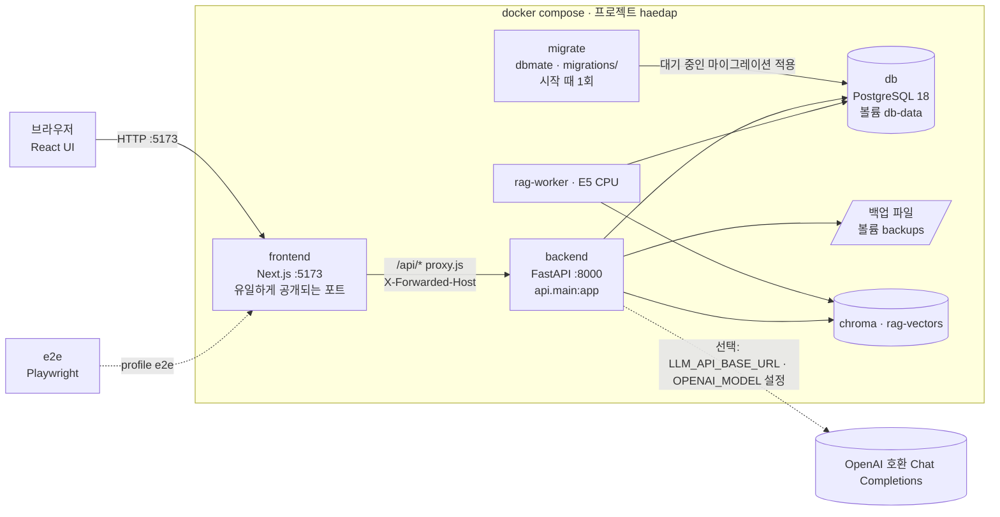
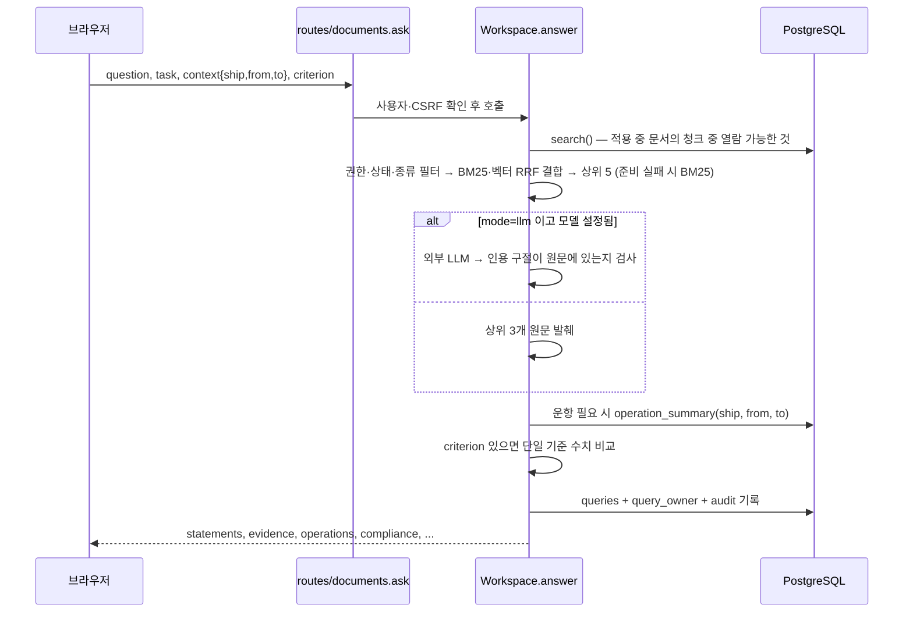

# 아키텍처

> 대상 버전: 1.4.0 · 최종 확인: 2026-10-28 (코드 대조)
> 이 문서는 **현재 구현**을 설명합니다. 앞으로 바꿀 계획은 [`plans/`](plans/), 바뀌지 않을 결정의 이유는 [`adr/`](adr/)에 있습니다.

## 현재 Python 문서 경로 (2026-10-13)

현재 실행 코드는 `backend/api/main.py`(FastAPI)와 `backend/api/store/`(PostgreSQL·업무 로직)이다. 전처리 모듈은 `api/` 패키지 안에 두어 backend 단독 실행과 Docker 운영 이미지에서 같은 경로로 사용한다.

문서 등록: `frontend/src/lib/pdf.js`가 브라우저에서 페이지별 텍스트를 추출 → `controller.jsx`에서 사용자가 검토한 본문을 sections로 변환 → `POST /api/changes` (`document.save`) → `api/store/documents.py`의 `DocumentStore.save_document` → `api/rag_preprocessing.py` → 기존 `documents`, `chunks`, `chunk_pages`, `document_files` 저장. 원본 PDF는 기존과 같이 base64로 보존하며 외부 추출 서비스에 보내지 않는다.

2026-10-18 문서 정보 수정 경로: `frontend/src/lib/document-save.js`가 정보 변경과 본문 개정을 구분한다. `document.save`의 `mode: "metadata"`는 같은 저장 모듈에서 현재 개정·정보 버전을 검사하고 `document_meta`만 갱신한다. 본문 개정은 새로 제공한 원문만 전송하고 기존 조회 청크를 원문으로 재사용하지 않는다. 신규 원문 전처리 결과가 0개면 저장을 거부한다. DB 스키마·검색 알고리즘·백업 구조는 유지한다.

전처리는 웹·DB 의존성이 없는 함수이고 문서 ID·제목은 저장 계층에서 기존 관계로 연결한다. 청킹 규칙과 변경 적용 범위는 [API 전처리 계약](specs/api.md#python-문서-전처리-계약-2026-10-13-확정), 검증과 새 구조 통합 기록은 [작업 기록](plans/2026-10-13-rag-preprocessing.md)에 있다. 2026-10-14부터 검색은 `api/rag_retrieval.py`의 BM25Okapi를 사용한다. 저장 계층이 권한·상태·종류를 먼저 필터링하고 모듈은 허용된 청크만 토큰화·정렬한다. PostgreSQL 저장·개정·전처리는 변경하지 않는다.

## 1. 한눈에 보기

### 업무 스킬 실행

기존 질문·문서·운항·보고서 화면의 재사용 SkillsPanel → 일반 앱 API `/api/skills/run` → `api/workflow_skills.py`의 고정 handler로 실행한다. 지침은 Docker에 이미 복사되는 `knowledge/skills/<id>/SKILL.md`에 있다. 모델은 지침·원문에 기반한 설명에만 선택적으로 쓰며, 식별자·기간·SQL·권한·수치를 생성하지 않는다. 여섯 기능의 기본 실행에는 LLM이 필요 없다. 독립 업무 스킬 메뉴는 없으며 이전 /skills는 /chat으로 이동한다. 문서 상세는 현재 활성 문서, 운항·보고서는 공통 선박·기간, 응답 평가는 현재 답변 ID로 초기화한다. 패널을 펼칠 때만 카탈로그를 요청한다. [계약](specs/workflow-skills.md), [ADR 0015](adr/0015-optional-model-workflow-skills.md).

선택 문서 ID는 권한·활성 개정본을 먼저 확인하고 SQL 조회 조건으로 제한한다. MRV 실행은 앱 선박의 명시 매핑·IMO 정체성을 검증한 뒤 기존 Python Tool을 호출한다. 일반 앱 경계를 통해 호출하므로 서버 Bearer를 브라우저에 전달하지 않는다. 보고서 초안 생성은 payload만 반환하며 별도 버튼으로 저장한다. 실행 기록은 기존 queries/query_owner/audit에 보관하고 새 스키마는 만들지 않는다.

해답은 frontend·backend·PostgreSQL·rag-worker·Chroma와 시작 시 실행하는 마이그레이션으로 구성됩니다.
사용자는 **Next.js 주소 하나**(기본 `http://localhost:5173`)로만 접속합니다. Next.js가 화면을 그리고,
`/api/*`를 FastAPI로 넘깁니다([ADR 0006](adr/0006-nextjs-entry-rewrites-to-api.md), [ADR 0007](adr/0007-runtime-api-origin-via-proxy.md)).
백엔드와 내부 worker가 PostgreSQL에 접근합니다.

`frontend/`(npm)와 `backend/`(uv)는 독립 패키지이고 최상위 `compose.yaml`이 서비스를 함께 띄웁니다.
최상위 `e2e/`는 스택을 브라우저로 검증합니다([ADR 0009](adr/0009-split-packages-and-compose.md)).



| 서비스 | 이미지(빌드 위치) | 포트 | 데이터 |
|---|---|---|---|
| `db` | `postgres:18-alpine` | 내부 5432 (개발 오버레이에서만 `127.0.0.1:5432` 공개) | 볼륨 `db-data` |
| `migrate` | `amacneil/dbmate:2.36.0` | 없음 | 최상위 `migrations/` 마운트. `up` 후 종료([ADR 0010](adr/0010-dbmate-migrations.md)) |
| `backend` | `backend/Dockerfile` (`prod`/`dev` 타깃) | 내부 8000 (개발 오버레이에서만 `127.0.0.1:8000` 공개) | 볼륨 `backups` → `/data/backups` |
| `chroma` | `backend/Dockerfile.chroma` (공식 Chroma 1.5.9 기반) | 내부 8000, 호스트 공개 없음 | 볼륨 `rag-vectors` → `/data/chroma` |
| `rag-worker` | backend와 같은 모델 포함 이미지 | 없음 | PG 작업 큐, 이미지 `/opt/models/e5-small` |
| `frontend` | `frontend/Dockerfile` (`prod`=standalone, `dev`=`next dev`) | `${HAEDAP_BIND:-127.0.0.1}:${PORT:-5173}` | 없음 |
| `e2e-*`, `e2e` | 같은 이미지·Dockerfile + `e2e/Dockerfile` | 공개 안 함 | DB·백업 모두 tmpfs (실행마다 빈 상태, `e2e-migrate`로 같은 마이그레이션 적용) |

- **운영 실행**: `docker compose up --build -d`. 시작 순서는 db(헬스체크 통과) → migrate(성공 종료) → backend(헬스체크 통과) → frontend입니다. 마이그레이션이 실패하면 backend가 시작하지 않습니다. backend 헬스체크는 `/api/health`를 호출하므로 DB 연결까지 확인합니다.
- **개발 실행**: `docker compose -f compose.yaml -f compose.dev.yaml up --build`. 소스를 컨테이너에 바인드 마운트하고 `uvicorn --reload`, `next dev`로 저장 즉시 반영합니다. Docker 없이 `backend/`에서 `uv run`, `frontend/`에서 `npm run dev`로 직접 실행하는 방법도 유지합니다([ADR 0005](adr/0005-dev-mode-direct-processes.md)).
- **API 주소**: `HAEDAP_API_ORIGIN`. compose에서는 `http://backend:8000`, 직접 실행에서는 기본 `http://127.0.0.1:8000`. `proxy.js`가 **요청마다** 이 값을 읽으므로 바꿔도 다시 빌드할 필요가 없습니다. 직접 실행할 때는 `next.config.mjs`가 이 값 하나만 최상위 `.env`에서 읽습니다.
- `next.config.mjs`는 `output: 'standalone'`으로 빌드하고, `next dev`는 `.next-dev`, 그 외에는 `.next`를 출력 폴더로 씁니다(`HAEDAP_NEXT_DIST`로 덮어쓰기 가능).
- 외부 네트워크는 선택적 LLM 호출에서만 사용합니다.

## 2. 요청 흐름

### 2.1 Next.js → FastAPI (`frontend/src/proxy.js`, `backend/api/web/handler.py`)

1. 브라우저 요청은 모두 Next.js가 받습니다. 화면·`/_next/*`·`frontend/public` 리소스는 Next.js가 직접 응답합니다.
2. `/api/:path*`는 `proxy.js`(Next.js 16의 `middleware` 후속, Node.js 런타임)가 `NextResponse.rewrite`로 `HAEDAP_API_ORIGIN/api/:path*`에 프록시합니다. 원래 `Host`는 `X-Forwarded-Host`에 들어갑니다. 쿠키·`Set-Cookie`는 그대로 오갑니다.
3. 프록시 설정(`experimental`): 요청 본문 최대 **101MB**(PDF 포함 문서 등록 38MB, 백업 가져오기 100MB), 응답 대기 **60초**.
4. FastAPI의 `/api/{path}` 하나가 모든 앱 API를 받습니다. 요청마다 PostgreSQL 연결을 열고(`Workspace`), 첫 요청에서 `bootstrap()`(명시적 초기 관리자 설정·기본 설정·`knowledge/seed.json` 문서 등록)을 한 번 실행합니다.
5. **Host·Origin 검사**(`validate_origin`): `X-Forwarded-Host`(없으면 `Host`)의 호스트 이름이 `localhost`, `127.0.0.1`, `HAEDAP_ALLOWED_HOSTS`에 있어야 하고, `Origin`이 있으면 같은 주소여야 합니다. 아니면 403.
6. 동시 요청 4개 제한, 백업 복구 중 다른 요청 차단(PostgreSQL advisory lock), 1분마다 자동 백업 여부 확인.
7. `MARITIME_DATA_API_TOKEN`이 설정되어 있으면 `/api/maritime-data/*` 라우터가 `/api/{path}`보다 먼저 등록됩니다(8절).

### 2.2 화면 (`frontend/`)

- `src/app/` — App Router 페이지. `/`는 `/chat`으로 리다이렉트. 페이지: `/chat`, `/documents`, `/documents/[id]`, `/operations`, `/reports`, `/reports/[id]`, `/admin`.
- `src/workspace/provider.jsx` — `WorkspaceProvider`가 작업공간 상태를 소유하고 컴포넌트는 `useSyncExternalStore`로 구독.
- `src/workspace/controller.jsx` — 사용자 이벤트 처리, API 호출, 대화상자, 초안 보존.
- `src/lib/api.js` — 유일한 서버 호출 지점. `X-Haedap-Token`(CSRF), `X-Haedap-Identity`(현재 사용자 확인) 헤더를 붙임.
- `src/lib/pdf.js` — 브라우저 안의 PDF.js로 텍스트 추출(업로드 PDF는 외부로 보내지 않음). `src/lib/csv.js` — 운항 CSV 파싱.
- `src/lib/model.js` — 클라이언트 상태 모델, 미저장 초안의 `localStorage` 보관.

### 2.3 통합 질문 (`POST /api/ask`)



응답 형식은 [`specs/integrated-answer.md`](specs/integrated-answer.md)를 따릅니다.

## 3. 모듈 책임 (`backend/`)

| 경로 | 책임 |
|---|---|
| `api/main.py` | FastAPI 앱 생성, lifespan(자동 백업 루프), 해사 데이터 라우터 마운트, 오류 응답 형식 |
| `api/web/handler.py` | `/api/{path}` 진입점: 요청 슬롯, Content-Type·본문 크기, DB 세션, 인증·CSRF 후 `routes.dispatch` |
| `api/web/security.py` | Host·Origin 검사, 기존 게스트 식별자, 개인 계정 세션(메모리), CSRF 토큰, 로그인 시도 기록 |
| `api/web/concurrency.py` | 동시 요청 4개 제한, 복구 단독 실행(프로세스 카운터 + PostgreSQL advisory lock) |
| `api/web/backup_job.py` | 1분마다 확인하는 하루 1회 자동 백업 |
| `api/routes/` | 경로 표와 도메인별 핸들러: `system`(health·tools), `auth`, `documents`(문서·PDF·ask·search·history), `operations`, `changes`, `reports`, `admin`(users·logs·backups) |
| `api/store/` | `Workspace` = `base.Database`(연결·트랜잭션) + 도메인 mixin: `users`, `documents`(청크 900자·검색), `operations`, `changes`, `reports`, `answers`(통합 답변·선택적 LLM), `tools`, `backups` |
| `api/config.py`, `api/deps.py` | 환경 설정(DB 주소, 백업 경로, 허용 호스트), `Workspace` 열기와 최초 1회 초기화 |
| `api/llm.py` | Chat Completions 호출, 선택적 JSON 출력 형식, 모델 JSON·원문 인용 검증. URL 호스트별 키 선택과 설정 판정은 `config.llm_settings()`를 health·답변이 공유 |
| `api/rag_preprocessing.py` | 저장 전 페이지별 텍스트 정리·경계 기반 최대 900자 청킹. DB·웹 의존성 없음 |
| `api/rag_retrieval.py` | 허용된 청크의 제목·출처·heading·본문을 토큰화해 BM25 정렬. 내부 score는 저장 계층에서 제거해 기존 evidence 응답 유지 |
| `api/rag_vocabulary.py` | Kiwi 해사 사용자 단어, 한영 별칭, 제한적인 불용어. 검색용 사전이며 원문은 변경하지 않음 |
| `api/errors.py`, `api/validation.py` | `ApiError`·`require`, 입력 검증·형식 도우미 |
| `knowledge/seed.json`, `knowledge/documents/`, `knowledge/sample-data.json` | 기본 문서와 그 원본 PDF(`file` 필드로 연결), "예시 데이터 넣기"용 가상 운항 기록 |
| `tools/` | 서비스 실행 중 사용하는 읽기 전용 해사 데이터 조회·계산·규칙 기반 조회 도우미(8절) |
| `tests/` | 앱과 해사 Tool pytest (`backend/`에서 `uv run pytest`) |

최상위 `scripts/`는 원본·공개 참조 자료 정규화, 전처리·품질 판정, 필드 사전 생성, CSV 적재 및 명시적 선박 연결을 담당합니다. backend uv 환경의 `data` 의존성 그룹을 사용하며 운영 이미지에는 포함하지 않습니다([ADR 0011 제안](adr/0011-tools-runtime-and-data-preparation.md)). 자료 준비는 서비스 시작이나 Tool 호출 때 자동 실행하지 않습니다.

DB 스키마는 backend가 아니라 최상위 `migrations/`(dbmate)가 소유합니다. backend는 테이블이 없으면 `SCHEMA_NOT_READY`(503)를 반환합니다.

개발자용 `scripts/debug_bm25.py`는 backend 기본 uv 의존성만 사용하는 읽기 전용 진단 도구다. `DocumentStore.search_candidates`의 기존 조회·권한·상태·kind 필터와 `rag_retrieval.query_tokens/chunk_tokens/retrieve`를 공유한다. API는 계속 score 없는 상위 5개를 반환하고, CLI만 점수·일치 토큰·미리보기를 출력한다. DB READ ONLY 트랜잭션에서 실행하며 초기화·저장·질문 이력·LLM 호출은 하지 않는다. 운영 이미지에는 스크립트를 포함하지 않고 실행할 때 읽기 전용 마운트한다. 기본 guest 또는 명시한 기존 활성 계정의 scope를 적용하며 DB 자격 증명을 가진 개발자 전용이다. [실행 방법](../README.md#bm25-개발자-디버그), [출력 계약](specs/api.md#개발자-진단-cli-계약-2026-10-15-확정).

개발자용 `scripts/evaluate_llm.py`는 기본 문서에서 고정 근거를 골라 한국어 생성만 비교한다. 기본 원문 발췌는 네트워크 없이 실행하고, 명시적 `--mode llm`만 기존 `api/llm.py`의 실제 모델 호출·원문 인용 검증을 사용한다. DB·검색·권한·이력 저장 경로를 호출하지 않으며 서비스 런타임에도 포함하지 않는다. 결과의 의미적 정답성은 사람 검토로 남긴다. [평가 계약](specs/llm-provider.md#7-한국어-생성고정-근거-평가-계약-2026-10-28-확정), [실행 방법](../README.md#한국어-답변-고정-근거-평가).

`frontend/tests/`는 CSV·PDF 유틸 단위 테스트(`npm test`), 최상위 `e2e/tests/`는 화면 → API → DB 전체 흐름 검증(Playwright)입니다.

## 4. 보안 경계

모듈을 교체하더라도 아래 경계는 유지해야 합니다.

- **접속 범위**: 공개되는 포트는 frontend 하나입니다. 기본 바인딩은 `127.0.0.1`(이 PC만). `HAEDAP_BIND=0.0.0.0`으로 LAN·서버 접속을 열고, 접속에 쓰는 호스트 이름·IP를 `HAEDAP_ALLOWED_HOSTS`에 넣습니다. TLS는 포함하지 않으므로 운영에는 앞단 HTTPS 리버스 프록시와 `HAEDAP_HTTPS=true`가 필요합니다. 외부 업무 접속은 조직의 VPN·추가 인증 정책을 함께 적용합니다.
- **내부 API·DB**: backend와 db는 compose 내부 네트워크에만 있고 운영 구성에서는 호스트에 공개하지 않습니다(개발 오버레이만 `127.0.0.1`로 공개). backend는 compose 네트워크 안에서만 접근되므로 로그인 시도 제한을 위해 `X-Forwarded-For`를 신뢰합니다(`--forwarded-allow-ips *`).
- **접속자 IP 범위**: 백엔드는 접속자 IP·서브넷을 검사하지 않습니다. 같은 서브넷으로 제한하려면 OS 방화벽을 씁니다(Ubuntu: `ufw allow from 192.168.0.0/24 to any port 5173`).
- **단일 출처**: 브라우저는 Next.js 주소 하나만 사용. Origin 검사는 실제 호스트(`X-Forwarded-Host`) 기준.
- **인증**: 선원·관리자·열람 계정의 서버 세션. 익명 업무 API 차단, 초기 비밀번호 교체, 30분 유휴·12시간 절대 만료, 계정 버전·활성 상태 재확인. HttpOnly·SameSite=Strict 및 HTTPS 운영 시 Secure 쿠키. 상세 계약은 [authentication.md](specs/authentication.md), 운영 조건은 [사용 안내 2절](user-guide.md#2-역할과-승인)을 따릅니다. backend 재시작 시 세션과 로그인 제한 기록이 초기화되는 단일 worker 구조입니다.
- **쓰기 보호**: 모든 POST는 JSON + `X-Haedap-Token` 필요. 원본 자료(문서·선박·운항) 변경은 서버에서 관리자 여부를 검사.
- **열람 범위**: 문서 `scope`(all/operator/admin)를 **검색 단계부터** 적용하고, 원본 PDF·보고서 근거·질문 이력 재열람에도 다시 검사.
- **LLM 인증키 격리**: `LLM_API_BASE_URL`을 파싱한 호스트가 `api.openai.com`이면 `OPENAI_API_KEY`, `dongguk.edu` 또는 하위 도메인이면 `DONGUK_AI_CHAT_API_KEY`만 선택. 해당 키가 없으면 모델 비활성. 로컬 Ollama·기타 호환 서버에는 두 키가 설정되어 있어도 인증 헤더를 보내지 않음. URL 경로·유사 도메인으로 키를 선택하지 않음([ADR 0013](adr/0013-provider-credential-isolation.md)).
- **LLM 출력 검증**: OpenAI 호환 `<LLM_API_BASE_URL>/chat/completions`에 권한 적용된 근거만 전달. JSON 출력 형식 강제는 `LLM_RESPONSE_FORMAT`의 선택 사항이고 앱의 JSON·인용 검증은 항상 적용. 정상 완료(`finish_reason=stop`)·최대 5개 문장·근거 ID·8자 이상 원문 인용을 검증하며 하나라도 틀리면 전체 폐기 후 발췌로 전환. health는 같은 설정 판정만 사용하며 모델 서버를 호출하지 않음([공급자 계약](specs/llm-provider.md)).
- **근거 없는 수치 금지**: 공식 CII와 규정 적용 판정은 산출하지 않고 `unavailable` / `unknown`과 사유를 반환.
- **비밀값**: `.env`(최상위)는 Git에서 제외. API 키는 backend 환경변수로만 전달하고 frontend 컨테이너에는 넣지 않습니다.

## 5. 교체 지점 (팀 모듈 연결)

| 바꾸려는 것 | 시작 위치 | 지켜야 할 계약 |
|---|---|---|
| 검색(벡터·하이브리드 RAG) | `api/store/documents.py`의 `search`, `save_document`의 청크 분할 | 열람 범위 필터 유지, evidence 필드 형식 |
| 답변 생성(LLM 공급자) | `api/llm.py`, `api/config.py`, `api/store/answers.py`의 `mode=llm` 분기 | [공급자 계약](specs/llm-provider.md), statements의 `chunkId`·`quote` 인용 검증 |
| 의도 분류·Agent | `api/store/answers.py`의 `answer` | [`specs/integrated-answer.md`](specs/integrated-answer.md) 출력 형식 |
| 계산 Tool 추가 | `api/store/tools.py`(`TOOL_DEFINITIONS`, 계산 메서드), `api/routes/system.py`(경로) | 입력 검증, `version`·`assumptions` 반환, `tool_runs` 기록 |
| 보고서 서식 | `api/store/reports.py`의 `generate_report` | 없는 값은 `[미입력 · 확인 필요]` |
| 새 서비스(로컬 LLM, 벡터 DB 등) | `compose.yaml`에 서비스 추가, backend 환경변수로 주소 전달 | 공개 포트는 frontend 하나 유지 |

연결 순서와 담당은 [`plans/2026-10-08-team-module-integration.md`](plans/2026-10-08-team-module-integration.md)를 참고하세요.

## 6. 빌드·실행 산출물

| 경로 | 생성 시점 | Git |
|---|---|---|
| `frontend/node_modules/`, `e2e/node_modules/` | `npm ci` (각 폴더) | 제외 |
| `backend/.venv/` | `uv sync` (`backend/`) | 제외 |
| `frontend/.next/`, `frontend/.next-dev/` | `npm run build`, `npm run dev` | 제외 |
| 볼륨 `haedap_db-data`, `haedap_backups` | `docker compose up` | — (`docker compose down -v`로 삭제됨) |
| `backend/data/` | 직접 실행 시 백업(`data/backups/`) | 제외 |
| `e2e/test-results/`, `e2e/playwright-report/` | e2e 실행 | 제외 |
| `schema_migrations` 테이블 | dbmate (적용한 마이그레이션 버전) | — |
| `.env` | 사용자가 직접 | 제외 |

## 7. 알려진 한계

- 문서 청크를 요청마다 읽고 권한 필터 후 메모리 BM25 인덱스를 만드는 캡스톤 데모 규모 설계. 대규모 운영에는 인덱스 재사용·페이징·파일 저장소·TLS·로그 보존 정책이 필요.
- 검색은 Kiwi 한국어 형태소·영숫자·제한된 해사 별칭·불용어 기반이다. 한글 bigram은 제거했다. 분석기와 동일 내용 청크의 분석 토큰을 프로세스 단위로 재사용한다. 토큰 캐시는 SHA-256 키·불변 튜플만 보관하며 최대 2,048항목·계산 객체 크기 합 16MiB의 LRU로 제한한다. 현재 DB에서 확인한 권한·선택 문서·활성 개정 후보만 검색에 참여하고 BM25 인덱스는 매 요청 새로 만든다. 결과·원문·질의·권한 인덱스는 캐시하지 않는다. 최초·변경·퇴출된 청크 분석과 큰 corpus의 인덱스 생성 비용은 남는다. 토큰 메모리 보관의 제한과 위험은 [ADR 0017 제안](adr/0017-bounded-chunk-token-reuse.md)에 기록했다. 사전 밖 용어·다의어·영문 활용형·의미 검색에는 한계가 있다. 작은 corpus의 BM25 점수는 0 또는 음수일 수 있으며 확률이 아니다. 상세 규칙은 [검색 계약](specs/api.md#문서-검색-bm25)을 따른다.
- 관리자 세션은 backend 프로세스 메모리에 있어 backend를 여러 개 띄우면 공유되지 않음.
- 질문 유형 분기는 단어 규칙 기반. 질문 속 날짜·선박명 자동 추출은 미구현.

## 8. 해사 데이터 Tool의 경계 (선택)

공개 제원 후보는 추가 migration의 `capacity_candidates`에 원본과 별도 보존한다. 참고 전용 `/api/maritime-data/reference-intensity`는 승인 MRV 보고와 후보를 같은 읽기 전용 스냅샷에서 연결하며, 미검증 범위 수용 입력·출처·경고·차단 사유를 유지한다. 원본 CO₂·DWT·거리나 기존 calculate 계약은 변경하지 않고, 공식 CII·등급은 산출하지 않는다. 참조 CSV 적재는 `scripts/load_capacity_candidates.py`가 담당한다. 운항 화면의 MRV 업무는 일반 앱 권한 경계에서 명시 매핑을 검증하고 기존 Python 계산을 호출한다. 통합 질문 `/api/ask`의 자동 MRV 호출과 자연어 Tool 선택은 후속 범위다.

`backend/tools/`는 PostgreSQL `maritime_data` 스키마의 승인 View를 읽기 전용으로 조회·계산합니다. backend와 같은 uv 프로젝트이며, `MARITIME_DATA_API_TOKEN`(32자 이상)을 설정하면 같은 FastAPI 프로세스에 `/api/maritime-data/*`로 마운트됩니다. 설정하지 않으면 라우트가 없습니다. 기본은 앱의 `DATABASE_URL`이며 `MARITIME_DATA_DATABASE_URL`로 별도 DB를 선택할 수 있습니다. 별도 DB에도 기본 init과 해사 마이그레이션을 모두 적용해야 하며 선박 외래키는 그 DB 안의 `public.ships`만 참조합니다.

```mermaid
flowchart LR
  R[별도 원본·참조 자료] --> P[scripts<br/>오프라인 전처리·품질·출처 보존]
  M[migrations/<br/>dbmate · DDL만 적용] --> S[(PostgreSQL 앱 테이블<br/>public.ships / operations)]
  M --> DB[(같은 DB · maritime_data<br/>MRV / Noon / 출처 / 품질)]
  P -->|migration 선행·빈 테이블 CSV 적재| DB
  B[브라우저] --> N[Next.js :5173]
  N -->|/api/* proxy.js| G[FastAPI backend]
  G --> S
  DB -. vessels.ship_id<br/>검토한 명시적 연결 .-> S
  G -->|/api/maritime-data/*<br/>Bearer 토큰 필요| T[tools 라우터]
  T -->|승인 View 읽기 전용| DB
```

`vessels.ship_id`의 선택적 외래키로 기존 앱 `ships`를 재사용합니다. 연결은 준비 CLI의 명시적 매핑으로만 수행하고 외부 선박 전체를 자동 등록하지 않습니다. MRV는 보고기간 단위이므로 기존 일별 `operations`로 분해하지 않습니다. 원본 식별자와 REAL/SYN 구분, 출처·품질 정보를 그대로 유지합니다.

독립 Tool 라우트는 서버 전용 Bearer 토큰을 요구합니다. 기존 화면의 실행 패널은 이 토큰을 받지 않고 일반 앱의 `/api/skills/run`을 호출합니다. 서버가 앱 ID의 명시 매핑과 IMO 정체성을 확인한 뒤 계산 함수를 직접 실행하고 queries/query_owner/audit에 기록합니다. 접근 범위는 기존 앱의 로그인·역할 기반 운항 조회 정책을 따르며 사용자별 선박 ACL은 추가하지 않았습니다. 공식 CII 등급은 생성하지 않으며, 독립 Tool `/ask`의 실제 LLM 호출은 계속 비활성입니다.

`tools.api.create_app()`은 테스트·역할4 도구용 독립 앱으로 남아 있습니다. 마이그레이션은 앱과 해사 DDL을 소유하고 loader는 DDL을 실행하지 않습니다. 기존 단일 스키마 채택·rollback 제한과 앱 복구 시 선박 연결 정책은 [데이터 모델](data-model.md#9-postgresql-해사-데이터-tool-선택)에 정의합니다. 입출력은 [API 명세](specs/tools.md), 데이터 확보는 [운영 안내](user-guide.md#10-해사-데이터-tool-선택)를 참고하세요.
## 로컬 벡터/RRF 검색 경계

`store/documents.py.search_candidates()`가 PostgreSQL에서 권한·활성 개정·상태·종류·선택 문서 범위를 확정한 뒤
`rag_search.py`가 `rag_retrieval.py`(BM25)와 `rag_vector.py`(Chroma)의 후보를 `rag_hybrid.py`(RRF)로 결합한다.
검색 후에는 BM25 fallback을 포함해 같은 DB 후보 조회를 다시 실행하고 원문·권한 변경 결과를 제거한다.
청킹/개정 규칙은 유지하고 저장 끝에 작업 enqueue만 추가한다. `/search`와 `/ask`는 같은 검색 경로를 사용한다.

`rag_embeddings.py`는 고정 E5 모델 계약·명시적 준비·입력 길이 검증을 담당한다.
`scripts/rag_index.py`는 DB 읽기 전용 스냅샷 → 파생 벡터 색인, `scripts/debug_retrieval.py`는 같은 후보의 세 방식 비교다.
Chroma 서버는 Docker 내부 전용이며 자동 worker와 함께 기본 실행되고 `backend/Dockerfile.chroma`로 별도 빌드한다.
공식 Chroma 1.5.9에 기존 UID/GID 10001·저장 경로와 bash HTTP 헬스체크만 추가한다.
CPU PyTorch·E5 실행·Python 클라이언트는 backend/worker에 있다. 모델은 이미지 `/opt/models/e5-small`, 벡터는 named volume이다.
PostgreSQL만 원본이므로 Chroma 결과의 본문을 신뢰하지 않고 현재 후보 행으로 결과를 구성한다.
BM25는 제한된 분석 토큰 캐시를 사용한다. CLI에서 명시적으로 BM25만 실행하면 E5/Chroma를 로딩하지 않는다.
상세 실패·부분 색인·동기화 정책은 [검색 계약](specs/rag-vector.md), 현재 선택 이유는 [ADR 0021](adr/0021-durable-index-jobs.md) 참고.

### 자동 색인 경계

`rag_jobs.enqueue`는 `save_document`와 같은 트랜잭션으로 작업을 기록한다.
정보만 수정하는 경로와 변경 없는 저장도 같은 작업을 요청한다. 원문·청크·PDF는 그대로 유지한다.
`rag_worker`는 전용 DB 세션에서 커밋된 작업을 획득하며 임베딩 동안 DB 트랜잭션을 열어두지 않는다.
세션 advisory lock은 중복 worker를 막고, generation/claim token은 오래된 완료를 막는다.
실패 정책·CLI 계약은 [rag-index-jobs](specs/rag-index-jobs.md)에 정의한다. 웹 응답은 색인을 기다리지 않는다.


worker는 모든 열람 범위의 활성 문서를 색인하는 서버 내부 작업자다. 검색의 사용자 권한 경계는 그대로 PG에서 확인한다.
복원 JSON에는 작업/벡터를 넣지 않으며 복원 후 명시적 enqueue로 재구축한다.
