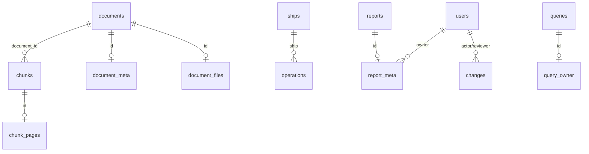
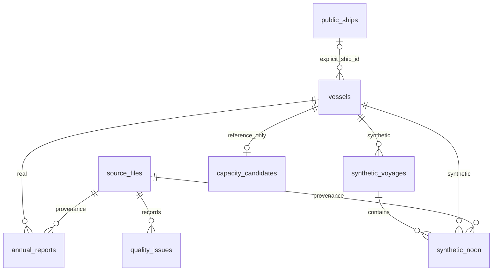

# 데이터 모델

> 대상: 기본 앱 1.4.0 + 선택 해사 데이터 Tool 계약 v1 · 최종 확인: 2026-10-15 (`migrations/`, `backend/api/store/`, `api/workflow_skills.py`, `scripts/` 대조)
> 테이블·필드·상태 값을 바꾸면 같은 작업에서 이 문서를 고치고, 되돌리기 어려운 변경이면 ADR을 남깁니다.

> 문서 전처리 통합은 `migrations/`의 PostgreSQL 테이블/컬럼을 바꾸지 않는다. `chunks.document_id`로 문서 제목을, `chunk_pages.id`로 물리 페이지를 조회한다. 기존 `haedap-chunk-v1` 문서 해시와 청크 ID를 유지하고 기존 개정본의 청크는 재작성하지 않는다. 새 문서·새 내용 개정의 분할 규칙만 [전처리 계약](specs/api.md#python-문서-전처리-계약-2026-10-13-확정)에 따라 달라진다.

## 1. 저장소 개요

- **엔진**: PostgreSQL(compose 서비스 `db`, `postgres:18-alpine`). FastAPI가 요청마다 `psycopg`로 연결하고 요청 단위 트랜잭션으로 커밋·롤백합니다.
- **위치**: `DATABASE_URL`. compose에서는 `db` 컨테이너, 데이터는 볼륨 `haedap_db-data`.
- **스키마**: 최상위 [`migrations/`](../migrations/)의 SQL 파일이 원본이고, dbmate가 순서대로 적용합니다([ADR 0010](adr/0010-dbmate-migrations.md)). 적용 이력은 `schema_migrations` 테이블에 있습니다. compose의 `migrate` 서비스가 `docker compose up` 때마다 대기 중인 파일을 적용한 뒤 backend가 시작합니다. 현재 테이블 정의는 [`20261013000000_init.sql`](../migrations/20261013000000_init.sql) 이후 파일들을 차례로 적용한 결과입니다.
- **JSON `body` 컬럼**: 선박·운항·문서 메타 등은 필드를 `jsonb`로 저장합니다. 검색·정렬에 쓰는 값(`ship`, `date` 등)만 별도 컬럼으로 뺍니다.



(관계선은 논리적 관계입니다. 실제 외래키는 `migrations/`의 SQL을 보세요 — 예: `chunks.document_id → documents.id`, `operations.ship → ships.id`.)

## 2. 문서와 검색

### `documents` — 문서 개정본(revision) 단위

| 컬럼 | 타입 | 설명 |
|---|---|---|
| `id` | TEXT PK | 개정 ID = `{logical_id}-{hash 앞 16자}` |
| `logical_id` | TEXT | 논리 문서 ID (영문 소문자·숫자·하이픈). 같은 문서의 개정본이 공유 |
| `hash` | TEXT | 정규화한 문서 JSON의 SHA-256 (`haedap-chunk-v1` 접두). 같으면 `unchanged` |
| `title`, `reference`, `version` | TEXT | 제목, 출처 조항, 버전명 |
| `kind` | TEXT | `onboard` · `official-summary` · `sample` |
| `url` | TEXT NULL | HTTPS 원문 URL (`official-summary`는 필수) |
| `reviewed_at` | TEXT | 확인일 `YYYY-MM-DD` |
| `language` | TEXT | `ko` · `en` |
| `active` | INTEGER | 1 = 현재 개정본. `UNIQUE(logical_id) WHERE active=1`로 하나만 허용 |
| `imported_at` | TEXT | ISO 시각 |

### `chunks` / `chunk_pages`

| 테이블 | 컬럼 | 설명 |
|---|---|---|
| `chunks` | `id`(=`{revision}-{n}`), `document_id`, `position`, `heading`, `text` | 절을 900자씩 분할 |
| `chunk_pages` | `id`(청크 ID), `page` | PDF 물리 페이지 번호(없으면 NULL → "페이지 미지정") |

검색(`Workspace.search`): 질문에서 영숫자 2자 이상·한글 2자 이상 단어를 최대 30개 뽑고 한영 동의어 묶음(`SEARCH_SYNONYMS`)을 더한 뒤, 열람 가능한 적용 중 문서의 청크마다 제목·조항·소제목·본문에 포함된 단어 수로 순위를 매겨 최대 5개를 반환합니다. 별도 검색 인덱스는 없습니다.

### `document_meta` / `document_files`

| 테이블 | 내용 |
|---|---|
| `document_meta(id, body)` | 개정본별 메타 JSON: `{scope, status, issuer, issuedAt, revisedAt, applicability, revision}` |
| `document_files(id, name, base64)` | 개정본의 원본 PDF (Base64, 25MB 이하). 새 개정에 파일이 없으면 이전 개정의 PDF를 복사 |

- `scope`: `all`(누구나) · `operator`(담당자·관리자) · `admin`(관리자만). 바꾸면 같은 논리 문서의 **모든 개정본**에 적용.
- `status`: `active`(사용 중) · `retired`(폐기) · `deleted`(삭제 — 행은 남기고 검색·열람에서 제외).
- `revision`: 메타 수정 시각(ms). 낙관적 잠금 `expectedMetaRevision`에 사용.
- 메타가 없으면 기본값 `{scope:'all', status:'active', …, revision:0}`.

## 3. 운항

### `ships(id, body, version, seq)`

`seq`는 등록 순서(identity)입니다. 목록과 화면의 기본 선박 선택이 이 순서를 따릅니다(`ORDER BY seq, id`). API 응답에는 나오지 않습니다.

`body` 필드:

| 필드 | 타입 | 필수 | 비고 |
|---|---|---|---|
| `id` | string | 자동 | UUID |
| `name` | string | ✓ | ≤100자 |
| `type` | string | ✓ | 선종, ≤80자 |
| `dwt` | number | ✓ | 1 ~ 1e7 t |
| `imo`, `from`, `to` | string | | 선택 |
| `sample` | boolean | | 가상 예시 여부 |

### `operations(id, ship, date, body, version)` — `UNIQUE(ship, date)`

| 필드 | 단위 / 범위 | 필수 |
|---|---|---|
| `ship` | 등록된 선박 ID | ✓ |
| `date` | `YYYY-MM-DD` | ✓ |
| `fuel` | t, 0 ~ 1e7 | ✓ |
| `factor` | tCO₂/t 연료, 0 초과 ~ 10 | ✓ |
| `distance` | nm, 0 ~ 1e7 | ✓ |
| `speed` | kn, 0 ~ 100 | ✓ |
| `fuelType` | 문자열 | ✓ |
| `position`, `voyage`, `weather`, `note` | 문자열 | |
| `draft` | m, 0 ~ 40 또는 null | |
| `engineHours` | h, 0 ~ 24 또는 null | |
| `sample` | boolean | |

규칙: 같은 선박·일자는 한 건. 직전 기록보다 연료가 2배 이상이면 `note` 5자 이상 필요. CSV 일괄 등록은 1~1,000행, 한 행이라도 실패하면 전체 미반영.

파생 값(저장하지 않음, `analysis.summarize`): `emission = Σ fuel×factor`, `intensity = emission×1e6 / (dwt×distance)` gCO₂/(DWT·nm), `speed` = 평균. 공식 CII는 항상 `{status:'unavailable'}`.

## 4. 보고서

| 테이블 | 컬럼 | 설명 |
|---|---|---|
| `reports` | `id`, `title`(≤120), `type`, `text`(≤200,000), `sources`(문서 ID JSON 배열), `version`, `updated_at` | 본문 |
| `report_meta` | `id`, `owner`(사용자 ID 또는 `guest_…`), `status`, `body`(JSON) | 소유·상태 |

- `type`: `규정 검토` · `일일 운항` · `배출량 검토` · `종합 검토`
- `status` 전이: `draft` → (검토 요청) `review` → (승인) `approved` / (반려) `draft`. `review`·`approved`는 수정 불가 → 복사해 새 초안.
- `body`(≤50,000자 JSON): 생성 초안은 `{template:'noon'|'mrv', ship, from, to, recordIds:[{id,version}], sample}`, 승인 시 `approvedBy`, `approvedAt` 추가.
- 업무 스킬 초안도 위 공통 필드를 유지하며 `skill`과 요청 당시 `scope:{ship,from,to}`를 추가한다. Noon의 `from/to`는 실제 마지막 기록일이고 `scope`는 사용자가 요청한 전체 기간이다.
- 열람: 관리자, 소유자, 또는 `approved` — 단, `sources`의 모든 문서를 열람할 수 있어야 함.

## 5. 사용자·이력·운영

| 테이블 | 컬럼 | 설명 |
|---|---|---|
| `users` | `id`, `username`(UNIQUE), `name`, `role`, `password`(`salt:scrypt hex`), `active`, `version` | `role`: `admin`(로그인 가능) · `operator` · `viewer`(이전 버전 호환, 로그인 불가). 기본 `admin`은 고정 |
| `queries` | `id`, `question`, `response`(통합 답변 JSON 전체), `created_at` | 질문 당시 답변 재열람용 |
| `query_owner` | `id`, `owner` | 질문 소유자 |
| `tool_runs` | `id`, `tool`, `version`, `input`, `output`, `created_at` | 계산 도구 실행 기록 |
| `changes` | `id`, `at`, `actor`, `kind`, `payload`, `status`, `reviewer`, `reviewed_at`, `note` | 변경·승인 이력 |
| `audit` | `id`, `at`, `actor`(이름), `category`, `action`, `target`, `detail`(JSON) | 감사 로그 (관리 화면 최근 500건) |
| `settings` | `key`, `value` | 아래 키 참고 |

`changes.kind`: `document.save`, `document.delete`, `ship.save`, `operation.save`, `operation.import`, `operation.delete`, `report.approve`.
`changes.status`: 관리자 직접 변경은 즉시 `approved`로 기록. 보고서 검토 요청(및 이전 버전의 요청)은 `pending` → `approved` / `rejected`.

`settings` 키: `schema`(`'2'`), `autoBackup`(`daily`|`off`), `autoBackupDay`(마지막 자동 백업 UTC 날짜), `publicAccessV1`(기본 관리자 일회성 이전 완료 표시).

## 6. 식별자와 동시성

- 대부분의 ID는 `randomUUID()`. 문서는 내용 해시 기반 개정 ID.
- **낙관적 잠금**: `ships`, `operations`, `reports`, `users`는 `version` 정수를 갖고, 요청의 `version`이 DB와 다르면 `409 VERSION_CONFLICT`. 저장 시 +1. 문서는 `expectedId`(현재 개정 ID)와 `expectedMetaRevision`으로 같은 검사를 합니다.
- 변경은 PostgreSQL 트랜잭션 하나로 처리하며 충돌 제어가 필요한 기존 행은 `FOR UPDATE`로 잠급니다.
- 일반 사용자 소유자 ID: `guest_` + `haedap_guest` 쿠키 값의 SHA-256.

## 7. 백업 형식

`HAEDAP_BACKUP_DIR/{uuid}.json` (compose: 볼륨 `haedap_backups`의 `/data/backups`, 직접 실행 기본값: `backend/data/backups`). 각 테이블을 `SELECT *` 그대로 담으므로 `ships.seq` 같은 컬럼도 포함되며, 복구는 컬럼 이름을 지정해 넣습니다(그 컬럼이 없는 이전 백업은 기본값으로 채움).

```json
{
  "format": "haedap-workspace",
  "version": 2,
  "createdAt": "2026-10-08T00:00:00.000Z",
  "label": "수동 백업",
  "tables": { "documents": [], "chunks": [], "reports": [], "tool_runs": [], "queries": [],
              "users": [], "document_meta": [], "document_files": [], "chunk_pages": [],
              "ships": [], "operations": [], "report_meta": [], "audit": [], "query_owner": [],
              "changes": [], "settings": [] },
  "checksum": "checksum 필드를 뺀 나머지 JSON의 SHA-256 hex"
}
```

- 복구 조건: `format`·`version:2`·체크섬 일치, 16개 테이블 모두 존재, 활성 관리자 1명 이상. 복구 직전 자동 백업을 만들고 한 트랜잭션에서 전체 교체합니다.
- `.env`(API 키)는 포함하지 않습니다.
- `maritime_data`의 테이블·원본·CSV는 앱 JSON 백업에 포함하지 않습니다. 앱 복구는 외부 해사 레코드를 삭제하지 않으며, 복구 전 연결한 `vessels.ship_id`는 복구 후 동일한 선박 정체성이 확인되는 경우만 재연결합니다. 누락되거나 정체성이 다르면 NULL로 남기고 재연결·미연결 건수를 기록합니다. 전체 해사 데이터는 별도 PostgreSQL 백업이 필요합니다(9절).

## 8. 스키마를 바꿀 때

1. 새 마이그레이션 파일을 만듭니다(최상위에서): `docker compose run --rm migrate new add_ship_flag` → `migrations/<시각>_add_ship_flag.sql`.
2. `-- migrate:up`에 변경을, `-- migrate:down`에 되돌리는 SQL을 씁니다. **이미 커밋된 마이그레이션 파일은 고치지 않고** 항상 새 파일을 추가합니다.
3. 적용·확인: `docker compose up -d`(자동 적용) 또는 `docker compose run --rm migrate up`, 상태는 `docker compose run --rm migrate status`, 직전 파일 되돌리기는 `docker compose run --rm migrate rollback`.
4. 백업 대상 테이블이면 `BACKUP_TABLES`에 추가하고, 이전 백업 복구 시의 동작을 정합니다(백업 `version`을 올릴지 결정 → ADR).
5. 이 문서의 해당 절을 갱신하고, `backend/tests/`에 회귀 테스트를, 화면 흐름에 영향이 있으면 e2e를 실행합니다(e2e 스택도 같은 마이그레이션으로 DB를 만듭니다).

## 9. PostgreSQL 해사 데이터 Tool (선택)

앱과 같은 PostgreSQL DB 안의 `maritime_data` 스키마입니다. 루트 dbmate 마이그레이션이 구조를 만들고, 별도 전처리·CSV 적재를 거친 자료만 조회합니다. 아래 여섯 원본·출처·품질 테이블과 두 조회 View가 기본 저장 모델이며, 별도 제원 후보 참조 테이블 하나를 추가합니다. 기존 `public.ships`는 선택적 외래키로 재사용하며 보고기간 MRV·합성 Noon·출처·품질은 독립적으로 보존합니다. 실제/합성·단위 정책은 [데이터 명세](specs/prepare-data.md), 조회·계산 입력은 [API 명세](specs/tools.md)에 정의합니다.

DDL의 원본은 [`20261013010000_maritime_data.sql`](../migrations/20261013010000_maritime_data.sql)입니다. 데이터 필드 사전은 `scripts/prepare_maritime_data.py`의 `FIELDS`에서 생성하며, 사전 생성은 DDL을 만들거나 마이그레이션 파일을 덮어쓰지 않습니다. SQL의 NOT NULL·CHECK·외래키는 아래 표의 필드 규칙에 추가 적용됩니다. 앱 테이블을 이 구조로 교체하거나 두 데이터를 자동 결합하지 않습니다([ADR 0011 제안](adr/0011-tools-runtime-and-data-preparation.md)).

### ERD



`quality_issues.record_id`는 연간/일별 레코드 중 하나를 가리키는 논리 참조입니다. SQL의 외래키는 source_id에만 적용합니다. 원본 조회는 record_id 및 출처 키로 수행합니다.

### 컬럼 정의

#### source_files — 원본 파일·출처

| 컬럼 | PostgreSQL 타입 | 제약 | 의미·단위 |
|---|---|---|---|
| source_id | text | PK | Dataset ID + SHA256 |
| dataset_id | text | required | DS-001..006 |
| filename | text | required | Original basename |
| sha256 | text | required | Original byte checksum |
| source_url | text | nullable | Source recorded in assessment; not license approval |
| data_origin | text | required | REAL / SYNTHETIC / REFERENCE / SCHEMA |
| granularity | text | required | report / daily / position / port / schema |
| selection | text | required | Selected use for this preparation |
| row_count | integer | required | Count read from original |
| header_json | jsonb | required | Original ordered headers; duplicate XLSX names preserved |

#### vessels — 실제·합성 선박 식별

| 컬럼 | PostgreSQL 타입 | 제약 | 의미·단위 |
|---|---|---|---|
| vessel_id | text | PK | REAL:IMO:<number> or SYN:<source vessel ID> |
| data_origin | text | required | REAL or SYNTHETIC; never joined across origins |
| imo_number | text | nullable | Seven-digit source IMO; synthetic remains NULL |
| source_vessel_id | text | required | Original IMO or synthetic vessel ID |
| ship_id | text | nullable FK public.ships(id), ON DELETE SET NULL | Explicitly reviewed app ship link; source vessel ID remains unchanged |

#### annual_reports — 실제 MRV 보고기간 집계

| 컬럼 | PostgreSQL 타입 | 제약 | 의미·단위 |
|---|---|---|---|
| record_id | text | PK | Stable source/sheet/row hash |
| source_id | text | FK source_files | Source version |
| source_sheet | text | required | CSV or original XLSX sheet |
| source_row | integer | required | Original row number; CSV is logical record number |
| vessel_id | text | FK vessels | Real vessel only |
| vessel_name | text | nullable | Name at reporting time |
| ship_type | text | nullable | Source classification, unmodified |
| reporting_year | integer | required | Reporting year |
| report_type | text | required | FULL / PARTIAL / ARCHIVE_ANNUAL |
| period_label | text | required | Original reporting period |
| period_start | date | nullable | Reported partial bounds or nominal annual boundary; not observation date |
| period_end | date | nullable | Reported partial bounds or nominal annual boundary |
| fuel_t | numeric | nullable | Source total fuel, tonnes; no fuel split invented |
| co2_t | numeric | nullable | Reported CO2 tonnes; not CO2-equivalent |
| sea_hours | numeric | nullable | Reported sea hours, aliases checked for agreement |
| fuel_kg_per_nm | numeric | nullable | Reported distance intensity |
| distance_nm_estimate | numeric | nullable | fuel_t * 1000 / intensity; scope not verified |
| dwt_t | numeric | nullable | Source value only; missing stays NULL |
| fuel_type | text | nullable | Not provided in MRV inputs |
| quality_status | text | required | VALID / REVIEW / REJECT |
| aggregate_eligible | boolean | required | False for partial, duplicate keys, invalid core numbers |
| provenance_json | jsonb | required | Per-field original columns, missing reasons, distance method |

#### synthetic_noon — 개발용 합성 일별 기록

| 컬럼 | PostgreSQL 타입 | 제약 | 의미·단위 |
|---|---|---|---|
| record_id | text | PK | Stable source/row hash |
| source_id | text | FK source_files | Source version |
| source_row | integer | required | Original CSV logical row |
| vessel_id | text | FK vessels | Synthetic vessel only |
| voyage_id | text | FK synthetic_voyages | Synthetic voyage key |
| report_date | date | required | Noon reporting date; observation period may straddle years |
| period_start_utc | timestamptz | required | Original interval start UTC |
| observed_at_utc | timestamptz | required | Original interval end UTC |
| vessel_name | text | required | Fictional source name |
| ship_type | text | required | Fictional source type |
| dwt_t | numeric | required | Fictional DWT tonnes |
| operating_status | text | required | Source SEA/PORT classification |
| distance_nm | numeric | required | Fictional daily distance; zero in port allowed |
| fuel_t | numeric | required | Fictional daily fuel tonnes |
| fuel_type | text | required | Source fuel label; not an official factor mapping |
| speed_kn | numeric | required | Fictional speed |
| engine_hours | numeric | required | 0..24 hours |
| quality_status | text | required | VALID / REVIEW / REJECT |
| provenance_json | jsonb | required | Simulation flags/version/seed and original missing reasons |

#### synthetic_voyages — 개발용 합성 항차

| 컬럼 | PostgreSQL 타입 | 제약 | 의미·단위 |
|---|---|---|---|
| voyage_id | text | PK | SYN:<source voyage ID> |
| vessel_id | text | FK vessels | Synthetic vessel |
| departure_port_label | text | nullable | Source label; no unverified WPI match |
| arrival_port_label | text | nullable | Source label; no unverified WPI match |
| first_report_date | date | required | First included report date, NOT departure time |
| last_report_date | date | required | Last included report date, NOT arrival time |
| mapping_status | text | required | UNMAPPED_PORT_LABELS / CONFLICT |

#### quality_issues — 전처리 품질 이슈

| 컬럼 | PostgreSQL 타입 | 제약 | 의미·단위 |
|---|---|---|---|
| issue_id | integer | PK | Sequence within deterministic run |
| record_id | text | nullable | Logical reference to annual/noon row |
| source_id | text | FK source_files | Input source version |
| source_row | integer | required | Original record row |
| severity | text | required | INFO / REVIEW / REJECT |
| field | text | required | Affected field |
| code | text | required | Machine-readable issue code |
| detail | text | required | Evidence without replacing original value |

### 조회 View와 추가 제약

#### capacity_candidates - 별도 공개 제원 후보

추가 DDL 원본은 [`20261013020000_capacity_candidates.sql`](../migrations/20261013020000_capacity_candidates.sql)이다. 기존 여섯 운영·출처·품질 테이블과 두 View를 바꾸지 않고 참조 테이블 하나를 더한다.

| 컬럼 | 타입·제약 | 의미 |
|---|---|---|
| vessel_id / imo_number | PK·vessels FK / 7자리, REAL:IMO와 일치 | 이름 대신 원본 IMO로 연결 |
| candidate_dwt_t | nullable numeric, 양수·1천만 미만 | 원본 MRV DWT와 구분한 미검증 후보 t |
| capacity_status | 정해진 상태 5종 | 미확보·단일 출처·5% 이내 일치·5% 초과 충돌 |
| source_file_sha256 / source_filename / source_row | SHA256 / text / 2 이상 정수 | 실제 적재한 CSV 바이트와 논리 레코드 위치 |
| source_json | required JSONB object | 출처별 DWT·GT·URL·제원·제한 등 CSV 원문 필드 |
| loaded_at | timestamptz, 기본 now() | 적재 시각이며 선박 제원의 기준연도가 아님 |

CLI는 REAL 선박·IMO, 출처별 DWT·선택값·충돌 상태를 검증하고 빈 참조 테이블에만 적재한다. 원본 annual_reports.dwt_t·vessels·앱 ships는 수정하지 않는다. 데이터가 있으면 migration down을 거절한다. 앱 JSON 백업은 기존 16개 테이블로 유지하며 참조 테이블·CSV는 PostgreSQL 및 파일 백업으로 보관한다. 과거 보고연도 당시 제원 검증이나 공식 입력 승격은 제공하지 않는다. 새 참조 버전 교체는 별도 검토가 필요하다.

| 객체 | 정의·목적 |
|---|---|
| `real_annual_query` | `annual_reports` 중 `aggregate_eligible=true`만 노출 |
| `development_noon_query` | `synthetic_noon` 중 `quality_status='VALID'`만 노출 |
| 인덱스 | MRV `vessel_id/reporting_year`, Noon `vessel_id/report_date`, Noon `voyage_id` |

- 연간·일별 레코드의 품질 값은 VALID/REVIEW/REJECT로 제한하며 선박 ID 접두어를 검사합니다.
- MRV의 보고 유형은 FULL/PARTIAL/ARCHIVE_ANNUAL이며 집계 적격이면 VALID 및 비PARTIAL이어야 합니다. 기간 경계가 모두 있으면 종료 ≥ 시작입니다.
- Noon은 DWT > 0, 거리·연료·속도 ≥ 0, 기관 운전시간 0~24시간, 종료시각 > 시작시각 및 최대 24시간을 검사합니다.
- 해사 데이터 내부 외래키는 `ON DELETE RESTRICT`입니다. 원본·품질 레코드를 연쇄 삭제하지 않습니다. 앱 선박 연결인 `vessels.ship_id`만 `ON DELETE SET NULL`이며 앱 선박이 없어져도 원본 해사 레코드는 보존합니다.
- 선박 연결은 검토한 명시적 매핑만 허용합니다. 이름·IMO로 자동 조인하거나 원본 선박 전체를 `ships`에 생성하지 않습니다. MRV 보고기간 값을 앱 일별 `operations`로 분해하지 않습니다.
- 명시 매핑 CLI는 실제 원본과 같은 IMO의 비샘플 앱 선박만 연결합니다. 합성은 확인 옵션과 sample 앱 선박이 필요합니다. 서로 다른 기존 연결 덮어쓰기·앱 선박 중복 연결은 거절하고 동일 연결은 멱등 처리합니다. 명령과 설정 우선순위는 [운영 안내](user-guide.md#기존-앱-선박에-명시적으로-연결하기)에 있습니다.

### 버전·적재·백업 경계

`20261013000000_init.sql`은 그대로 유지하고 새 해사 마이그레이션을 그 뒤에 적용합니다. 기본 앱과 같은 `DATABASE_URL`을 사용합니다. `MARITIME_DATA_DATABASE_URL`로 별도 DB를 선택해도 그 DB에 기본 init과 해사 마이그레이션을 모두 적용해야 하며, 외래키는 그 DB의 `public.ships`만 참조합니다.

새 마이그레이션은 fresh DB에서는 빈 해사 테이블을 만듭니다. 이전 `role4` 또는 `maritime_data` 스키마가 하나만 있으면 기대 테이블·컬럼·구조를 검증한 뒤 채택하고, 양쪽이 함께 있거나 구조가 맞지 않으면 전체 변경을 거절합니다. 원본·운항 레코드는 재작성하지 않습니다. 해사 테이블에 데이터가 있으면 down을 거절하므로 일반 앱 rollback 명령으로 원본을 삭제하지 않습니다. 이름을 되돌려야 하는 기존 환경은 별도 보존·이전 계획이 필요합니다.

CSV loader는 DDL을 실행하지 않습니다. 마이그레이션이 적용되어 있고 6개 대상 테이블이 모두 빈 경우에만 한 트랜잭션 안에서 검증 후 적재합니다. 하나라도 데이터가 있으면 삭제·재적재하지 않고 거절합니다. CSV·원본·출처 해시는 별도 데이터 버전으로 보존합니다. 실행 절차와 이전 환경의 설정 전환은 [운영 안내](user-guide.md#10-해사-데이터-tool-선택)에 있습니다.

기본 앱의 JSON 백업에는 해사 테이블과 원본 파일이 포함되지 않습니다. 앱 복구는 현재 해사 선박 연결을 보관한 뒤 앱 선박을 교체하고, 동일한 정체성의 선박만 재연결합니다. 삭제·불일치 연결은 NULL로 두며 처리 건수를 복구 결과·감사에 남깁니다. 이 보존 절차는 과거 연결까지 복원하는 해사 백업을 대체하지 않습니다. 별도로 PostgreSQL 백업과 원본·전처리 산출물을 보관해야 합니다. 공개 제원·환경성능 참조 자료는 별도 데이터 폴더에 관리하며, 현재 위 여섯 운영 테이블에 자동 적재하거나 공식 CII 입력으로 사용하지 않습니다.
